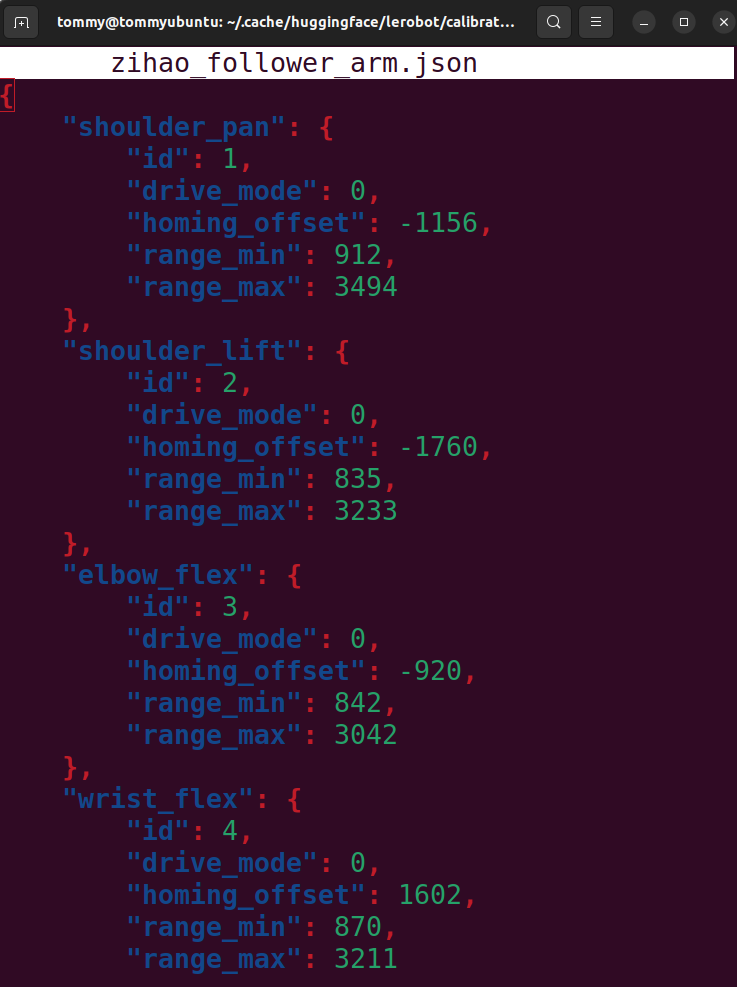

# Schritt 3: Roboterarm kalibrieren (Ubuntu)

## Port Berechtigungen erteilen

Allen Benutzern Lese- und Schreibzugriff auf diese seriellen Geräte geben

```Shell
sudo chmod 666 /dev/ttyACM*
```

## Follower-Folgearm kalibrieren

```Shell
lerobot-calibrate \
    --robot.type=so101_follower \
    --robot.port=/dev/ttyACM0 \
    --robot.id=my_follower_arm
```

::: warning Kalibrierhinweis

Bevor Sie die Kalibrierung mit Enter starten, bringen Sie den Roboterarm in die Mittelstellung – jedes Gelenk in der Mitte seines nutzbaren Bereichs.

Achten Sie auf Minimal- und Maximalwert jedes Gelenks. Wenn ein Minimalwert über 0 springt und plötzlich von 4095 abwärts läuft oder ein Maximalwert 4095 überschreitet und von 0 aufwärts läuft, führen Sie mit der Feetech-PC-Software eine Mittelstellungskalibrierung durch und kalibrieren Sie den Roboterarm anschließend erneut.

:::


## Leader-Führungsarm kalibrieren

```Shell
lerobot-calibrate \
    --teleop.type=so101_leader \
    --teleop.port=/dev/ttyACM1 \
    --teleop.id=my_leader_arm
```

::: warning Kalibrierhinweis

Bevor Sie die Kalibrierung mit Enter starten, bringen Sie den Roboterarm in die Mittelstellung – jedes Gelenk in der Mitte seines nutzbaren Bereichs.

:::


## Kalibrierungskonfigurationsdatei anzeigen

```Shell
sudo nano /home/<Benutzername>/.cache/huggingface/lerobot/calibration/robots/so101_follower/my_follower_arm.json
```



## Hinweise

### ① Ein Arm bleibt nach Erreichen des Endanschlags stehen

Eine erneute Kalibrierung ist erforderlich

[wx_camera_1768098182808.mp4](/downloads/wx_camera_1768098182808.mp4)

### ② Servo wird nicht gefunden


Das Servo ist nicht an die Stromversorgung angeschlossen

<RelatedProducts slugs="so-arm101" />
