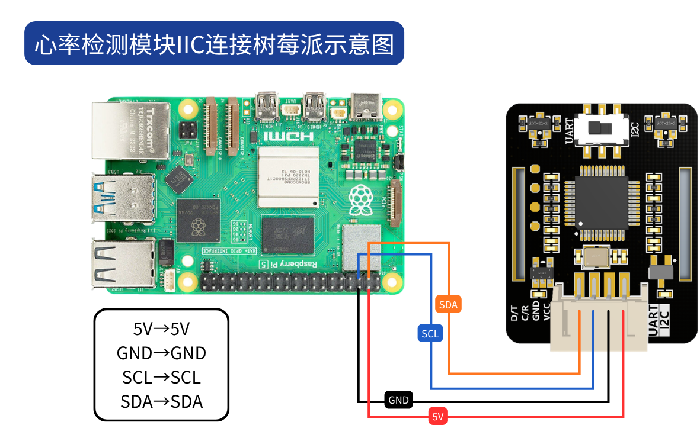
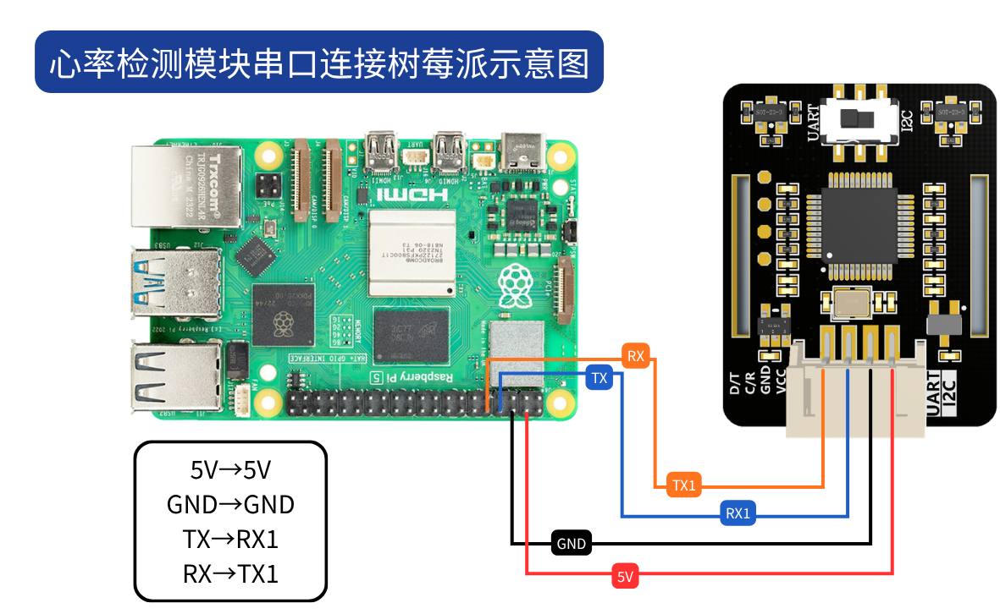
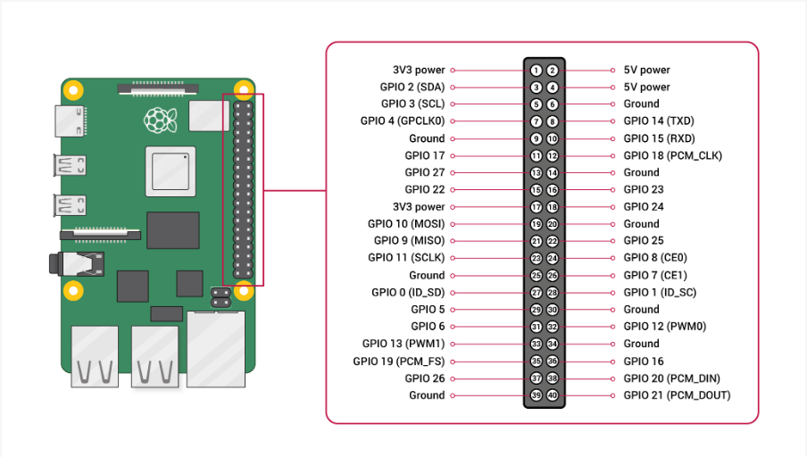

# Tutorial de Raspberry Pi

## Introducción al proyecto

JUXI_HeartRate_SPO2 es un módulo sensor de frecuencia cardíaca y SpO2 basado en el chip MAX30102; su algoritmo integrado puede entregar directamente los valores de frecuencia cardíaca y saturación de oxígeno.

**Funciones principales:**

- Medición de saturación de oxígeno (SPO2)
- Medición de frecuencia cardíaca (veces/minuto)
- Medición de temperatura de la placa
- Compatibilidad con dos modos de comunicación: UART e I2C

---

## Preparación del hardware

| Material necesario | Descripción |
|---|---|
| Raspberry Pi (2/3/4/Zero) | Se recomienda Raspberry Pi 3B+ o 4B |
| Sensor JUXI_HeartRate_SPO2 | Módulo sensor de frecuencia cardíaca y SpO2 |
| Cables Dupont (varios) | 4 cables Dupont hembra a hembra |
| Adaptador de alimentación | Fuente de alimentación específica para Raspberry Pi |

---

## Conexión de hardware

### Opción 1: comunicación I2C (recomendada)

El cableado I2C es sencillo; se recomienda su uso.



| Pin del sensor | Pin físico de Raspberry Pi | Número BCM | Descripción |
|---|---|---|---|
| VCC | 1 o 17 | - | Alimentación 3,3V (también admite 5V) |
| GND | 6 o 9 o 14 | - | Tierra |
| SDA | 3 | GPIO2 | Línea de datos I2C |
| SCL | 5 | GPIO3 | Línea de reloj I2C |

**Importante:** desplace el interruptor del sensor a la posición **IIC**.

### Opción 2: comunicación serie UART

La comunicación UART requiere conexión cruzada.



| Pin del sensor | Pin físico de Raspberry Pi | Número BCM | Descripción |
|---|---|---|---|
| VCC | 2 o 4 | - | Alimentación 5V (también admite 3,3V) |
| GND | 6 o 9 o 14 | - | Tierra |
| RX | 8 | GPIO14 | RX del sensor conectado al TX de la Raspberry Pi |
| TX | 10 | GPIO15 | TX del sensor conectado al RX de la Raspberry Pi |

**Importante:** desplace el interruptor del sensor a la posición **UART**.



---

## Configuración del entorno

### 1. Habilitar I2C (necesario en modo I2C)

```bash
sudo raspi-config
```

Seleccione `Interface Options` → `I2C` → seleccione `Yes` para habilitarlo

Reinicie la Raspberry Pi:

```bash
sudo reboot
```

### 2. Habilitar el puerto serie (necesario en modo UART)

```bash
sudo raspi-config
```

Seleccione `Interface Options` → `Serial`

- Primera pregunta: "Would you like a login shell to be accessible over serial?" → seleccione `No`
- Segunda pregunta: "Would you like the serial port hardware to be enabled?" → seleccione `Yes`

Reinicie la Raspberry Pi:

```bash
sudo reboot
```

### 3. Instalar las bibliotecas de dependencias

```bash
# 更新软件源
sudo apt-get update

# 安装 I2C 工具和 smbus2 库（I2C 模式必须使用 smbus2）
sudo apt-get install -y i2c-tools python3-smbus2

# 安装 pyserial（串口支持）
sudo pip3 install pyserial
```

> **Nota:** el modo I2C requiere obligatoriamente `smbus2`; no se puede usar la versión antigua `python-smbus`.
La biblioteca utiliza internamente `smbus2.i2c_msg` para implementar transacciones I2C independientes en dos pasos (primero escribe la dirección del registro y envía STOP, y luego abre una nueva transacción de lectura para leer varios bytes consecutivos), con el fin de satisfacer los requisitos de temporización I2C del chip sensor.

### 4. Verificar la conexión I2C (modo I2C)

Una vez completado el cableado, ejecute el siguiente comando para detectar el dispositivo I2C:

```bash
i2cdetect -y 1
```

Si aparece la dirección `0x57`, el sensor se ha conectado correctamente.

---

## Uso del código de ejemplo

[JUXI_HeartRate_SPO2.zip](https://juxitech.feishu.cn/wiki/W2IwwDop5i4BVlk98EacfyJvnrh)

### Estructura de archivos

```bash
python/raspberry/
├── JUXI_HeartRate_SPO2.py      # 主库文件
└── examples/
    ├── i2c_example.py          # I2C 模式示例
    └── uart_example.py         # UART 模式示例
```

### Ejecutar el ejemplo en modo I2C

```bash
cd python/raspberry/examples
```

```bash
sudo python3 i2c_example.py
```

### Ejecutar el ejemplo en modo UART

```bash
cd python/raspberry/examples
```

```bash
sudo python3 uart_example.py
```

**Nota:** para usar el puerto serie por hardware se necesitan permisos `sudo`.

### Resultado de ejecución

Si todo funciona correctamente, verá una salida similar a la siguiente:

```bash
==================================================
JUXI 心率血氧传感器 - I2C 模式
==================================================

正在初始化 I2C 总线 1，地址 0x57...
传感器初始化成功！

开始数据采集...
传感器 LED 已亮起！

请将手指放在传感器上...

血氧饱和度: 98 %
心率: 72 次/分钟
板载温度: 25.5 ℃
...
```

Pulse `Ctrl+C` para detener el programa.

---

## Referencia de la API

### Clase: JUXI_HeartRate_SPO2_i2c

Clase de sensor para el modo de comunicación I2C.

**Constructor**

`JUXI_HeartRate_SPO2_i2c(bus_number=1, i2c_address=0x57)`

Parámetros:

- `bus_number`: número del bus I2C; en Raspberry Pi suele ser 1
- `i2c_address`: dirección I2C del sensor; por defecto 0x57

**Métodos**

| Método | Descripción | Valor de retorno |
|---|---|---|
| begin() | Inicializa el sensor y detecta la conexión | bool (devuelve True si tiene éxito) |
| sensor_start_collect() | Inicia la adquisición de datos (el sensor se enciende) | Ninguno |
| sensor_end_collect() | Detiene la adquisición de datos (el sensor se apaga) | Ninguno |
| get_heartbeat_SPO2() | Lee la frecuencia cardíaca y el SpO2 | Ninguno (los resultados se guardan en los atributos del objeto) |
| get_temperature_c() | Lee la temperatura de la placa | float (grados Celsius) |
| close() | Cierra la conexión I2C | Ninguno |

**Atributos**

| Atributo | Descripción |
|---|---|
| SPO2 | Saturación de oxígeno (%), valor no válido -1 |
| heartbeat | Frecuencia cardíaca (veces/minuto), valor no válido -1 |

---

### Clase: JUXI_HeartRate_SPO2_uart

Clase de sensor para el modo de comunicación serie UART.

**Constructor**

`JUXI_HeartRate_SPO2_uart(port='/dev/serial0', baudrate=9600)`

Parámetros:

- `port`: ruta del dispositivo de puerto serie; en Raspberry Pi, por defecto `/dev/serial0`
- `baudrate`: velocidad en baudios; por defecto 9600

**Métodos**

Igual que `JUXI_HeartRate_SPO2_i2c`.

---

## Preguntas frecuentes

### P1: ¿Qué hacer si falla la inicialización del sensor?

**A:** Siga estos pasos para comprobarlo:

1. **Comprobar el cableado**
  - Modo I2C: confirme que SDA va a GPIO2 y SCL a GPIO3
  - Modo UART: confirme que RX-TX están conectados de forma cruzada

1. **Comprobar el interruptor del sensor**
  - Modo I2C: el interruptor debe estar en la posición IIC
  - Modo UART: el interruptor debe estar en la posición UART

1. **Comprobar la alimentación**
  - Confirme que VCC está conectado a 3,3V o 5V
  - Confirme que GND está conectado

1. **Comprobar la configuración del sistema**
  - Modo I2C: confirme que I2C está habilitado
  - Modo UART: confirme que el puerto serie está habilitado

1. **Usar los comandos de detección**

```bash
# I2C 模式
i2cdetect -y 1

# UART 模式
ls /dev/serial*
```

### P2: ¿Qué hacer si los datos muestran siempre -1?

**A:**

1. Confirme que el dedo está correctamente colocado sobre el sensor, cubriendo por completo los dos LEDs
1. Espere unos segundos a que los datos se estabilicen (normalmente se necesitan de 10 a 30 segundos)
1. Compruebe si se ha llamado a `sensor_start_collect()` para iniciar la adquisición
1. Confirme si el indicador LED del sensor está encendido

### P3: ¿Qué hacer si los datos son imprecisos?

**A:**

1. Asegúrese de que el dedo cubre por completo la zona óptica del sensor
1. Mantenga el dedo quieto, sin moverlo
1. Espere más de 30 segundos a que los datos se estabilicen
1. Realice varias mediciones y obtenga el promedio
1. Evite la luz intensa directa sobre el sensor

### P4: ¿Se pueden usar I2C y UART al mismo tiempo?

**A:** No; solo se puede elegir un modo de comunicación a la vez.

### P5: ¿Es necesario ejecutar con sudo?

**A:**

- Modo I2C: se recomienda usar sudo para evitar problemas de permisos
- Modo UART: es obligatorio usar sudo; de lo contrario, no se puede acceder al puerto serie

---

## Precauciones

### Técnicas de medición

1. **Coloque el dedo correctamente**
  - Apoye suavemente el dedo sobre el sensor, cubriendo los dos LEDs
  - No presione con fuerza para no afectar la circulación sanguínea
  - Mantenga el dedo estable, sin moverlo

1. **Espere a que los datos se estabilicen**
  - Al principio de la medición, los valores pueden ser inestables
  - Se recomienda esperar de 10 a 30 segundos a que los datos se estabilicen antes de leerlos
  - El sensor actualiza los datos cada 4 segundos

1. **Requisitos del entorno**
  - Evite la luz intensa directa sobre el sensor
  - Mantenga una temperatura ambiente adecuada
  - Mantenga un entorno tranquilo durante la medición

### Interpretación de los datos

| Rango de SPO2 | Descripción |
|---|---|
| 95% - 100% | Normal |
| 90% - 94% | Hipoxia leve |
| < 90% | Hipoxia; se recomienda acudir al médico |

| Rango de frecuencia cardíaca | Descripción |
|---|---|
| 60 - 100 veces/min | Rango normal de un adulto |
| < 60 veces/min | Bradicardia |
| > 100 veces/min | Taquicardia |

### Aviso de seguridad

- Este sensor es solo de referencia y no puede sustituir a un equipo médico profesional
- Si tiene problemas de salud, acuda al médico a tiempo
- Los resultados de medición son solo de referencia y no sirven como base de diagnóstico
