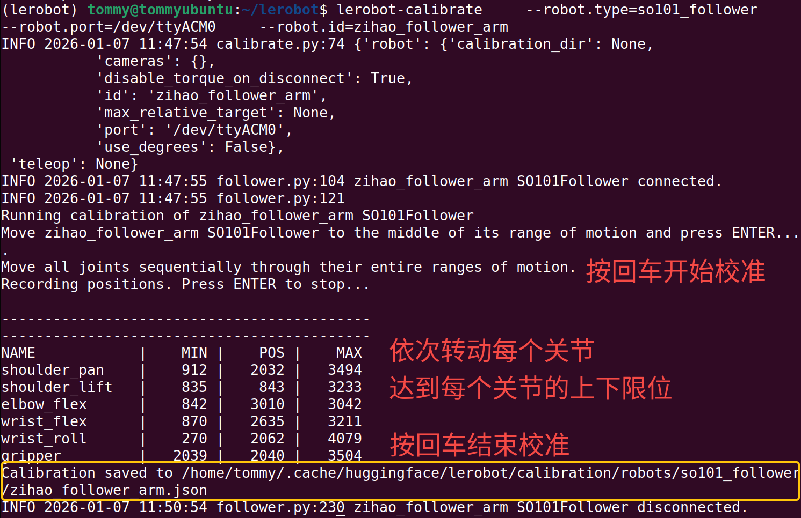
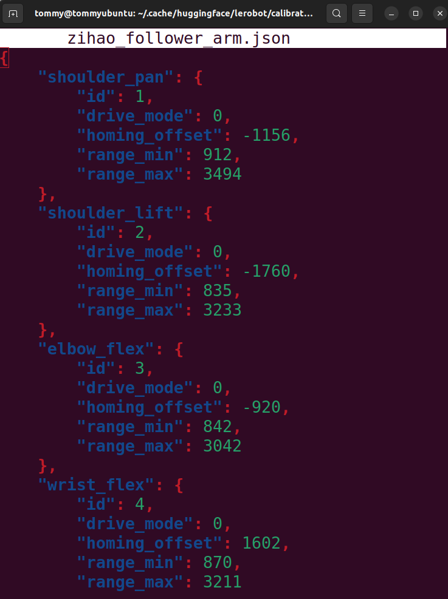

# Paso 3: Calibrar el brazo robótico (Ubuntu)

## Otorgar permisos al puerto

Permitir que todos los usuarios tengan permiso de lectura y escritura en estos dispositivos de puerto serie

```Shell
sudo chmod 666 /dev/ttyACM*
```

## Calibrar el brazo seguidor Follower

```Shell
lerobot-calibrate \
    --robot.type=so101_follower \
    --robot.port=/dev/ttyACM0 \
    --robot.id=my_follower_arm
```

::: warning Aviso de calibración

Antes de pulsar Enter para iniciar la calibración, coloque el brazo robótico en la posición media: cada articulación en el centro de su rango utilizable.

Observe los valores mínimo y máximo de cada articulación. Si un mínimo cruza 0 y empieza a decrecer desde 4095, o un máximo supera 4095 y empieza a crecer desde 0, realice una calibración de posición media con el software de PC de Feetech y vuelva a calibrar el brazo robótico.

:::



## Calibrar el brazo líder Leader

```Shell
lerobot-calibrate \
    --teleop.type=so101_leader \
    --teleop.port=/dev/ttyACM1 \
    --teleop.id=my_leader_arm
```

::: warning Aviso de calibración

Antes de pulsar Enter para iniciar la calibración, coloque el brazo robótico en la posición media: cada articulación en el centro de su rango utilizable.

:::


## Ver el archivo de configuración de calibración

```Shell
sudo nano /home/<usuario>/.cache/huggingface/lerobot/calibration/robots/so101_follower/my_follower_arm.json
```



## Notas

### ① Uno de los brazos llega al límite y deja de moverse

Es necesario recalibrar

[wx_camera_1768098182808.mp4](/downloads/wx_camera_1768098182808.mp4)

### ② No se encuentra el servomotor


El servomotor no está enchufado

<RelatedProducts slugs="so-arm101" />
