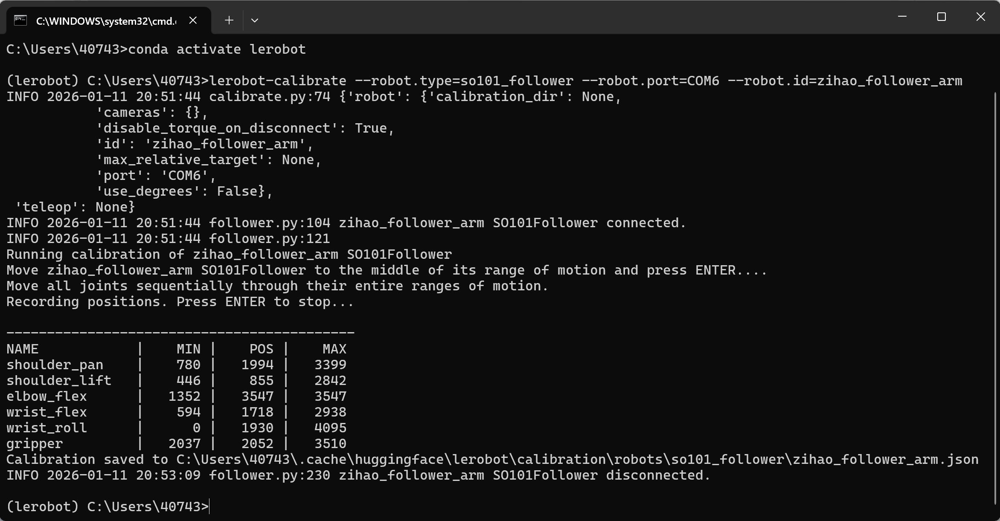
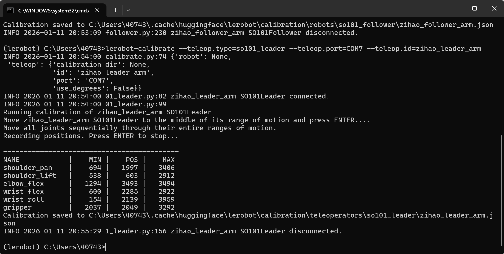
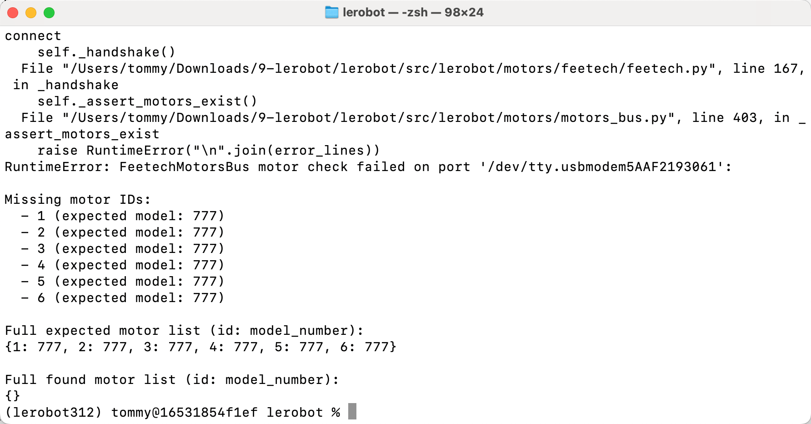

# Paso 3: Calibrar el brazo robótico (Windows)

Es necesario conectar al mismo tiempo el brazo líder y el brazo seguidor

## Calibrar el brazo seguidor Follower

```Shell
lerobot-calibrate --robot.type=so101_follower --robot.port=COM6 --robot.id=my_follower_arm
```

Antes de pulsar Enter para iniciar la calibración, coloque el brazo robótico en la posición media: cada articulación en el centro de su rango utilizable.

Observe los valores mínimo y máximo de cada articulación. Si un mínimo cruza 0 y empieza a decrecer desde 4095, o un máximo supera 4095 y empieza a crecer desde 0, realice una calibración de posición media con el software de PC de Feetech y vuelva a calibrar el brazo robótico.



## Calibrar el brazo líder Leader

```Shell
lerobot-calibrate --teleop.type=so101_leader --teleop.port=COM7 --teleop.id=my_leader_arm
```

Antes de pulsar Enter para iniciar la calibración, coloque el brazo robótico en la posición media: cada articulación en el centro de su rango utilizable.



## Ubicación de exportación de archivos

C:\Users\<usuario-Windows>\.cache\huggingface\lerobot\calibration\robots\so101_follower\my_follower_arm.json

C:\Users\<usuario-Windows>\.cache\huggingface\lerobot\calibration\teleoperators\so101_leader\my_leader_arm.json

## Calibrar otro brazo robótico

lerobot-calibrate --robot.type=so101_follower --robot.port=COM4 --robot.id=my_follower_arm

## Notas

### ① Uno de los brazos llega al límite y deja de moverse

Es necesario recalibrar

[wx_camera_1768098182808.mp4](/downloads/wx_camera_1768098182808.mp4)

### ② No se encuentra el servomotor



El servomotor no está enchufado; vuelve a enchufarlo y desenchufarlo, y gira un poco el conector

<RelatedProducts slugs="so-arm101" />
