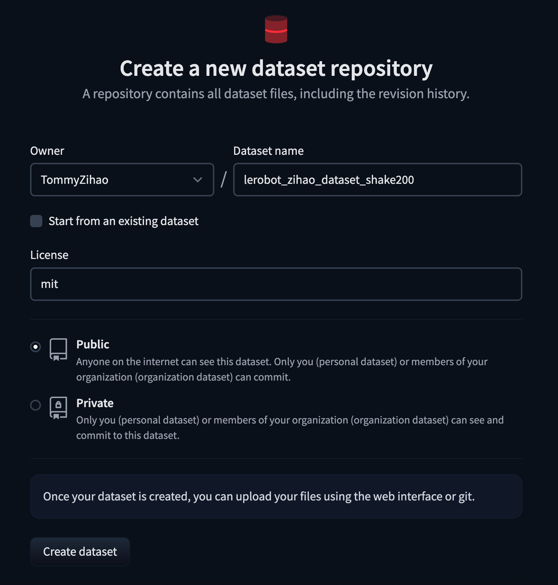
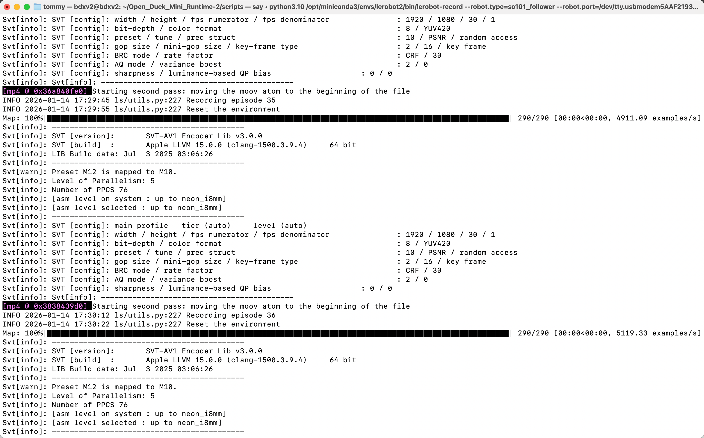
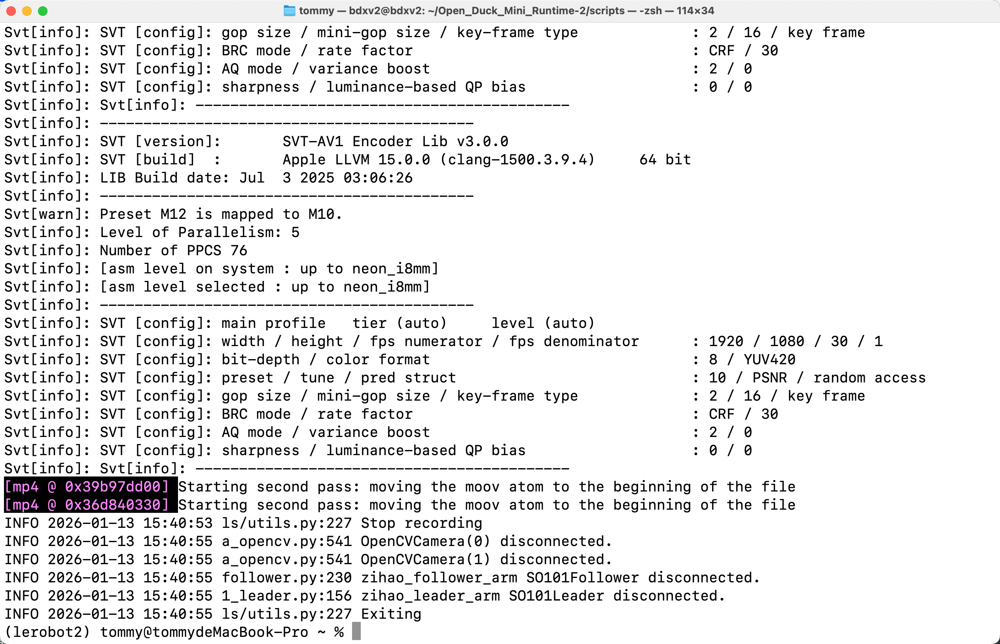

# Paso 6: Recopilación por demostración — Handshake 200

## Crear un repositorio de conjunto de datos en HuggingFace

https://huggingface.co/new-dataset



## Eliminar cualquier conjunto de datos existente con el mismo nombre (si lo hay)

```Shell
sudo rm -rf /Users/tommy/.cache/huggingface/lerobot/Tommymy/lerobot_my_dataset_shake200
```

## Recopilación del conjunto de datos Shake200

Una cámara, recopilar un conjunto de datos - computadora con Mac

```Shell
lerobot-record \
    --robot.type=so101_follower \
    --robot.port=/dev/tty.usbmodem5AAF2193061 \
    --robot.id=my_follower_arm \
    --robot.cameras="{ front: {type: opencv, index_or_path: 0, width: 1920, height: 1080, fps: 60, fourcc: "MJPG"}}" \
    --teleop.type=so101_leader \
    --teleop.port=/dev/tty.usbmodem5AAF2194741 \
    --teleop.id=my_leader_arm \
    --display_data=true \
    --dataset.repo_id=Tommymy/lerobot_my_dataset_shake200 \
    --dataset.num_episodes=200 \
    --dataset.single_task="Shanke Hands" \
    --dataset.push_to_hub=false \
    --dataset.episode_time_s=12 \
    --dataset.reset_time_s=1
```

## Durante la recopilación





Controles con las teclas de flecha del teclado:
→ (flecha derecha) Termina el episodio actual antes de tiempo; pasa al siguiente episodio.
← (flecha izquierda) Cancela el episodio actual; vuelve a grabarlo.
ESC, detiene de inmediato, codifica el vídeo y sube el conjunto de datos.

## Recopilación finalizada — directorio de guardado del conjunto de datos

```Shell
/Users/tommy/.cache/huggingface/lerobot/Tommymy/lerobot_my_dataset_shake200
```

<RelatedProducts slugs="so-arm101" />
