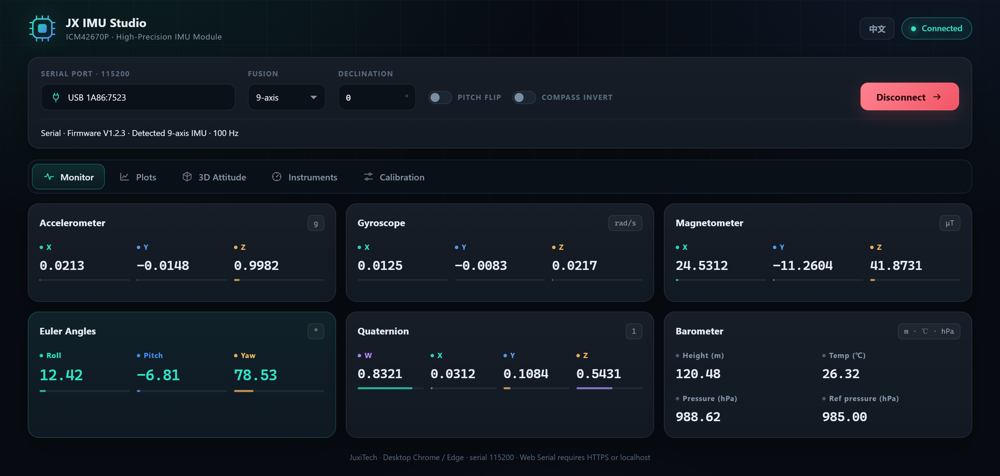
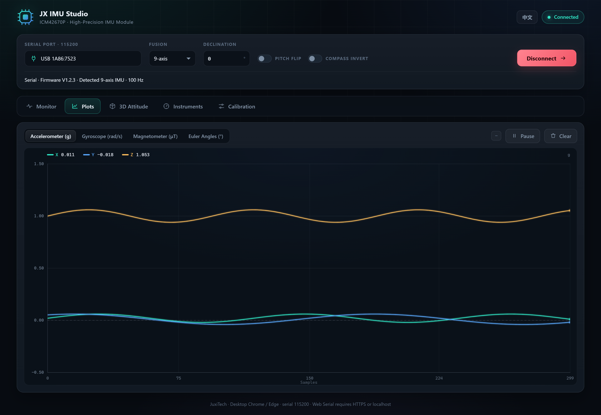
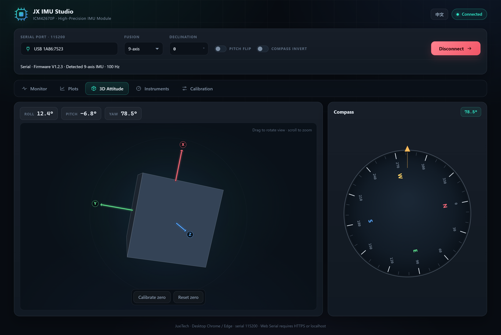
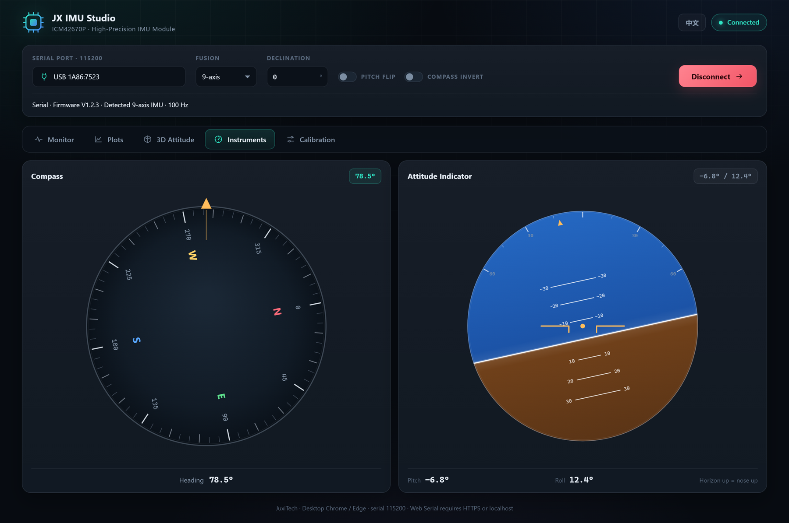
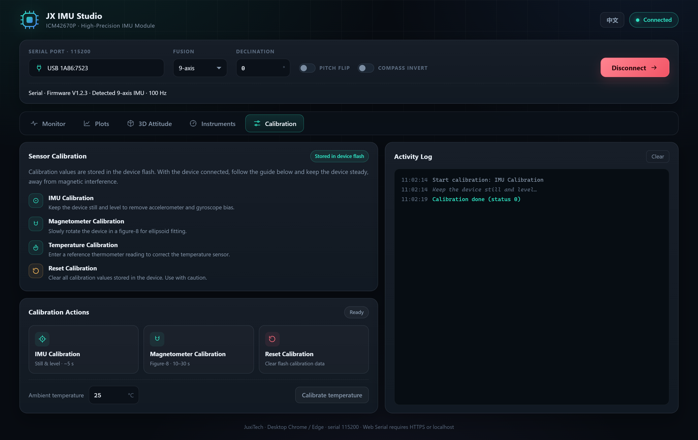

# Consola web del host – Guía de uso

Esta guía explica cómo usar **JX IMU Studio** en el navegador para conectar, monitorizar y calibrar el módulo IMU de alta precisión de JuxiTech. La versión web no requiere instalación: se conecta al puerto serie mediante la API Web Serial y puede desplegarse en GitHub Pages.

> La versión web solo admite Chrome / Edge de escritorio. Los navegadores no pueden acceder a I2C; los usuarios de I2C deben seguir usando el controlador del sistema o las herramientas de escritorio. La interfaz puede cambiar entre chino e inglés; las capturas muestran la interfaz en inglés.

## 1. Abrir la página

En línea:

<https://juxi-technology.github.io/ICM42670P-High-Precision-IMU-Module/>

Vista previa local (opcional, requiere Python):

```bash
python -m http.server 5173 --directory <directorio web>
```

Después abra <http://localhost:5173>. Web Serial requiere un contexto seguro (HTTPS o localhost); abrir `index.html` mediante `file://` puede desactivar el puerto serie.

## 2. Requisitos

- **Chrome / Edge** de escritorio (se recomienda 89 o superior)
- Controlador USB-serie (CH340, CP210x, etc.)
- Dispositivo encendido, velocidad **115200**
- Firefox, Safari y los navegadores móviles no admiten Web Serial
- No es necesario instalar Python, Qt ni software cliente

## 3. Conectar el dispositivo

1. Abra la página; el origen está fijado en **Serie**.
2. Haga clic en **Elegir dispositivo serie…** y seleccione el puerto del IMU en el diálogo del navegador (por ejemplo `USB-SERIAL CH340`).
3. Haga clic en **Conectar**. El estado cambia a **Conectado** y muestra la versión de firmware, los ejes detectados y la velocidad de datos.
4. La consola detecta automáticamente hardware de 6 / 9 / 10 ejes y muestra el algoritmo de fusión; los dispositivos de 10 ejes usan el algoritmo de 9 ejes.
5. Pulse **Desconectar** al terminar. Si se desenchufa el dispositivo, la página se desconecta automáticamente.



> En el primer uso, el navegador solicita permiso para acceder al puerto serie. Si la lista está vacía, instale primero el controlador USB-serie.

## 4. Descripción de la interfaz

La barra superior contiene el puerto serie, el algoritmo de fusión, la declinación magnética, la inversión de cabeceo, la inversión de brújula y el botón de conexión. Debajo hay cinco pestañas:

| Pestaña | Función |
|---------|---------|
| Monitorización | Acelerómetro, giroscopio, magnetómetro, ángulos de Euler, cuaternión, barómetro |
| Gráficas | Cuatro grupos de curvas desplazables, pausa y borrado |
| Actitud 3D | Cubo 3D, flechas de ejes, brújula, calibración de cero |
| Instrumentos | Tarjeta de brújula giratoria y horizonte artificial |
| Calibración | Calibración de IMU, magnetómetro, temperatura y reinicio |

El botón **EN / 中文** de la esquina superior derecha cambia el idioma de la interfaz.

## 5. Monitorización

Seis tarjetas muestran valores en tiempo real:

- **Acelerómetro**: unidad g, ±16 g; en reposo y horizontal, el eje Z muestra aproximadamente +1 g.
- **Giroscopio**: unidad rad/s, ±2000 °/s; cerca de 0 en reposo.
- **Magnetómetro**: unidad μT, ±800 μT; el campo terrestre es de unos 25–65 μT.
- **Ángulos de Euler**: Roll / Pitch / Yaw en grados; Yaw de 0 a 360°.
- **Cuaternión**: W / X / Y / Z, norma unitaria.
- **Barómetro**: altura (m), temperatura (℃), presión (hPa) y presión de referencia (hPa) en modelos de 10 ejes.

La barra de color bajo cada valor indica su proporción respecto al fondo de escala.

## 6. Gráficas

- Cambie de grupo en la parte superior: Acelerómetro (g) / Giroscopio (rad/s) / Magnetómetro (μT) / Ángulos de Euler (°).
- Cada grupo tiene tres curvas X/Y/Z o Roll/Pitch/Yaw con colores fijos.
- Cada curva conserva las últimas **300 muestras**, a unos 100 Hz.
- **Pausa** congela la gráfica; **Borrar** reinicia los búferes. Cambiar de grupo no borra los demás.
- La leyenda muestra el último valor de cada canal.



> La gráfica de ángulos de Euler muestra un salto vertical cuando Yaw pasa de 360° a 0°; es un envolvente de ángulo, no un error de datos.

## 7. Actitud 3D

- El cubo gira en tiempo real con Roll / Pitch / Yaw.
- **Arrastre con el botón izquierdo** para girar la vista y **rueda** para hacer zoom.
- Los ejes X / Y / Z son flechas roja / verde / azul, siempre dibujadas sobre el cubo para que sean legibles.
- La brújula de la derecha es una tarjeta giratoria: las marcas y N/E/S/W giran con el dispositivo, mientras que el indicador dorado superior representa el rumbo.
- **Calibrar posición actual**: fija la actitud actual como cero; solo afecta a la vista 3D y no se escribe en el dispositivo.
- **Reiniciar calibración**: elimina el desplazamiento de cero.



## 8. Instrumentos

- **Brújula**: la tarjeta gira con el rumbo y el indicador dorado permanece fijo arriba; el valor del rumbo se muestra arriba y abajo.
- **Horizonte artificial**: el límite cielo/suelo se desplaza con el cabeceo y gira con el alabeo. Horizonte por encima del centro significa morro arriba; por debajo, morro abajo.
- Si la N sigue al dispositivo en lugar de señalar el norte, active **Compass invert**.
- Si el morro arriba se muestra abajo, active **Pitch flip** (Roll y Pitch se invierten juntos).



## 9. Calibración de sensores

La página de calibración ofrece cuatro operaciones; el registro muestra el código de estado devuelto por el dispositivo:

1. **Calibración IMU**: coloque el dispositivo plano y quieto, haga clic y manténgalo inmóvil unos segundos para corregir el sesgo del acelerómetro y del giroscopio.
2. **Calibración del magnetómetro**: haga clic y gire lentamente el dispositivo en forma de 8 durante 10–30 segundos, cubriendo todas las orientaciones; manténgalo alejado de teléfonos, motores y objetos ferromagnéticos.
3. **Calibración de temperatura**: introduzca la temperatura ambiente actual (−50 ℃ a 50 ℃) y pulse **Calibrar temperatura**.
4. **Reiniciar calibración**: borra todos los valores guardados en la flash del dispositivo. Úselo con cuidado y vuelva a calibrar después.

Los botones se desactivan durante la calibración y el estado muestra **Calibrando…**. Al terminar, el registro muestra **Calibración completada (estado 0)** o el estado devuelto. Si se agota el tiempo, aparece un aviso; compruebe la conexión y reintente.



## 10. Correcciones de dirección

- **Declinación**: compensación de rumbo en ±180°. Introduzca un valor negativo si la brújula indica al oeste del norte verdadero y positivo si indica al este; en el este de China es de unos −4° a −10°. También sirve para corregir el ángulo de montaje.
- **Inversión de cabeceo**: invierte Roll y Pitch a la vez, útil cuando el sistema de coordenadas del dispositivo es opuesto a la convención del software.
- **Inversión de brújula**: invierte solo el giro de la brújula, sin afectar a la actitud 3D ni a los valores.

Las tres opciones están en la barra de conexión y se aplican al instante, sin reconectar.

## 11. Solución de problemas

**P1: No aparece ningún dispositivo al pulsar «Elegir dispositivo serie…».**
Compruebe el cable USB y la alimentación, instale el controlador CH340/CP210x y pruebe otro puerto o cable.

**P2: Conectado pero sin datos.**
Confirme que la velocidad es 115200 y que el puerto no está ocupado por otro programa; desconecte y vuelva a conectar el dispositivo.

**P3: El navegador indica que Web Serial no es compatible.**
Use Chrome / Edge de escritorio sobre HTTPS o localhost. Firefox, Safari y los navegadores móviles no son compatibles.

**P4: El dispositivo se desconecta durante el uso.**
La página vuelve al estado desconectado y muestra un aviso; vuelva a enchufarlo y conéctelo de nuevo.

**P5: El Yaw deriva lentamente.**
Un dispositivo de 6 ejes no tiene referencia magnética, por lo que la deriva de Yaw es normal. En dispositivos de 9/10 ejes, realice primero la calibración IMU y del magnetómetro y aléjese de interferencias magnéticas.

**P6: La brújula tiene un desfase fijo respecto al norte.**
Ajuste la **Declinación**: negativa hacia el oeste, positiva hacia el este. Si el sentido de giro está invertido, active **Compass invert**.

**P7: La vista 3D o el instrumento muestra morro arriba/abajo invertido.**
Active **Pitch flip**; Roll y Pitch se invierten juntos.

## 12. Datos y privacidad

La versión web es una página puramente estática sin servidor backend. Los datos serie se procesan y muestran solo en el navegador y nunca se envían a la red. La página no carga scripts de terceros ni código de analítica. Al cerrar la página, los datos desaparecen.
