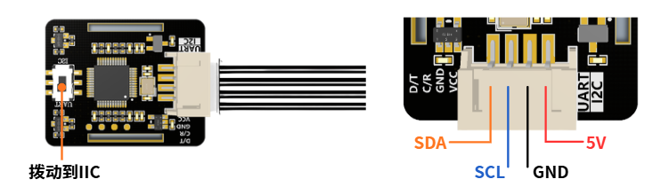
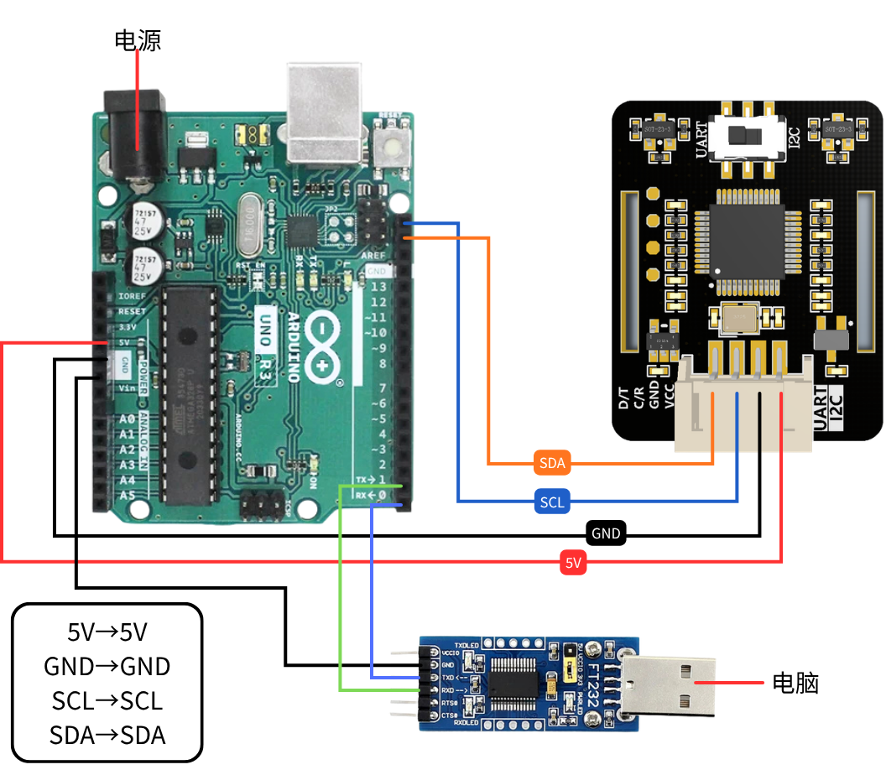
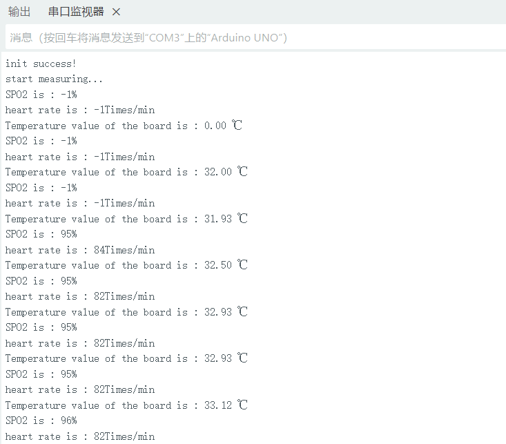
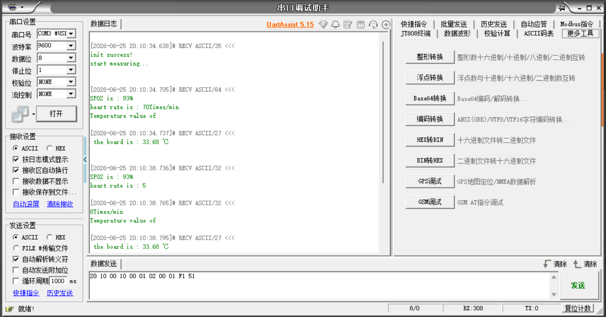

# Guide Arduino

## Présentation du capteur

JUXI_HeartRate_SPO2 est un module capteur de fréquence cardiaque et SpO2 basé sur la puce MAX30102 ; son algorithme intégré fournit directement la fréquence cardiaque et la saturation en oxygène.

**Fonctions principales :**

- Mesure de la saturation en oxygène (SPO2)
- Mesure de la fréquence cardiaque (battements/min)
- Mesure de la température de la carte
- Prise en charge de la communication I2C

---

## Guide Arduino

### Préparation du matériel

| Matériel nécessaire |
|---|
| Carte Arduino (Uno/ESP32, etc.) |
| Capteur JUXI_HeartRate_SPO2 |
| Câbles Dupont (plusieurs) |
| Câble USB (pour relier l'Arduino à l'ordinateur) |

### Installation de la bibliothèque

1. Téléchargez le fichier de la bibliothèque [JUXI_HeartRate_SPO2.zip](https://juxitech.feishu.cn/wiki/W2IwwDop5i4BVlk98EacfyJvnrh)
1. Décompressez l'archive et copiez-la dans le répertoire des bibliothèques Arduino :
  - Windows : `C:\Users\用户名\Documents\Arduino\libraries\`
  - Mac : `~/Documents/Arduino/libraries/`
  - Linux : `~/Arduino/libraries/`

1. Redémarrez l'IDE Arduino

### Téléversement de l'exemple de code

> Attention : lors du téléversement du code, connectez uniquement l'Arduino à l'ordinateur, ne connectez pas le module de mesure de fréquence cardiaque et SpO2 à l'Arduino !

#### Variante 1 : exemple en mode UART

Commentez la ligne #define I2C_COMMUNICATION, puis téléversez le code sur l'Arduino.

```cpp
#include "JUXI_HeartRate_SPO2.h"

// I2C 地址
#define I2C_ADDRESS 0x57

// 创建传感器对象，I2C模式
JUXI_HeartRate_SPO2_I2C sensor(&Wire, I2C_ADDRESS);

void setup() {
  Serial.begin(9600);

  // 初始化传感器
  while (!sensor.begin()) {
    Serial.println("传感器初始化失败，请检查连接！");
    delay(1000);
  }
  Serial.println("传感器初始化成功！");

  // 启动数据采集
  sensor.sensorStartCollect();
}

void loop() {
  // 读取心率和血氧数据
  sensor.getHeartbeatSPO2();

  // 输出血氧饱和度
  Serial.print("血氧饱和度: ");
  Serial.print(sensor._sHeartbeatSPO2.SPO2);
  Serial.println(" %");

  // 输出心率
  Serial.print("心率: ");
  Serial.print(sensor._sHeartbeatSPO2.Heartbeat);
  Serial.println(" 次/分钟");

  // 读取并输出温度
  Serial.print("板载温度: ");
  Serial.print(sensor.getTemperature_C());
  Serial.println(" ℃");

  Serial.println("------------------------");

  // 传感器每4秒更新一次数据
  delay(4000);
}
```

##### Câblage matériel

Communication I2C





| Broche du capteur | Arduino |
|---|---|
| VCC | 5V/3.3V |
| GND | GND |
| SDA | SDA/A4 |
| SCL | SCL/A5 |

- Placez le commutateur du module de mesure de fréquence cardiaque et SpO2 sur IIC !!!
- Reliez l'Arduino à l'ordinateur avec le câble de données

#### Résultat :

1. Ouvrez dans l'IDE Arduino : Outils → Moniteur série

Réglez le débit sur 9600



2. Ouvrez l'assistant de débogage série

[Assistant de débogage série uartassist5.15.zip](https://juxitech.feishu.cn/wiki/BJlfwSQydi7u5lkRDQ6cV4dvnBd)

Sélectionnez le numéro de port

Réglez le débit sur `9600`

Bits de données `8`, bit d'arrêt `1`, parité `NONE`, contrôle de flux `NONE`

Pour les réglages de réception et d'émission, choisissez `ASCII`



### API

| Fonction | Description |
|---|---|
| begin() | Initialise le capteur, renvoie true/false |
| getHeartbeatSPO2() | Lit la fréquence cardiaque et le SpO2, stockés dans la structure _sHeartbeatSPO2 |
| getTemperature_C() | Lit la température de la carte (degrés Celsius) |
| sensorStartCollect() | Démarre l'acquisition (la LED du capteur s'allume) |
| sensorEndCollect() | Arrête l'acquisition (la LED du capteur s'éteint) |

### À propos des données

- **SPO2 (saturation en oxygène)** : plage normale 95% - 100%, la valeur -1 signifie que la mesure est invalide
- **Heartbeat (fréquence cardiaque)** : plage normale 60 - 100 battements/min, la valeur -1 signifie que la mesure est invalide
- **Cause des valeurs invalides** : doigt mal placé ou données pas encore stabilisées

---

## Précautions d'utilisation

### Conseils de mesure

1. **Bien placer le doigt**
  - Posez délicatement le doigt sur le capteur en couvrant les deux LED
  - N'appuyez pas fort, pour ne pas gêner la circulation sanguine
  - Gardez le doigt stable, sans bouger

1. **Attendre la stabilisation des données**
  - En début de mesure, les valeurs peuvent être instables
  - Attendez 10-30 secondes que les données se stabilisent avant de les lire
  - Le capteur actualise les données toutes les 4 secondes

1. **Environnement**
  - Évitez la lumière directe et intense sur le capteur
  - Maintenez une température ambiante agréable
  - Restez au calme pendant la mesure

### Interprétation des données

| Plage SpO2 | Description |
|---|---|
| 95% - 100% | normale |
| 90% - 94% | légère hypoxie |
| < 90% | hypoxie, consultez un médecin |

| Plage de fréquence cardiaque | Description |
|---|---|
| 60 - 100 battements/min | plage normale chez l'adulte |
| < 60 battements/min | bradycardie |
| > 100 battements/min | tachycardie |

---

## Questions fréquentes

### Q1 : Que faire si l'initialisation du capteur échoue ?

**R :**

1. Vérifiez le câblage (SDA sur GPIO2/A4, SCL sur GPIO3/A5)
1. Vérifiez l'alimentation (3,3 V ou 5 V)
1. Détectez l'appareil avec la commande `i2cdetect -y 1`
1. Vérifiez que le commutateur du capteur est bien sur IIC

### Q2 : Que faire si les données affichent toujours -1 ?

**R :**

1. Vérifiez que le doigt est correctement placé sur le capteur
1. Attendez quelques secondes que les données se stabilisent
1. Vérifiez que `sensorStartCollect()` a bien été appelé pour démarrer l'acquisition
1. Vérifiez que le voyant du capteur est allumé

### Q3 : Que faire si les données sont imprécises ?

**R :**

1. Assurez-vous que le doigt couvre entièrement la zone optique du capteur
1. Gardez le doigt immobile
1. Attendez plus de 30 secondes pour stabiliser les données
1. Réalisez plusieurs mesures et faites la moyenne

### Q4 : Quelles cartes Arduino sont prises en charge ?

**R :** Sont prises en charge :

- Arduino Uno/Mega
- ESP8266
- ESP32
- D'autres cartes compatibles avec l'environnement Arduino

---

## Emplacement des fichiers d'exemple

### Exemple Arduino

```text
JUXI_HeartRate_SPO2/
└── examples/
    └── gainHeartbeatSPO2/
        └── gainHeartbeatSPO2.ino
```
