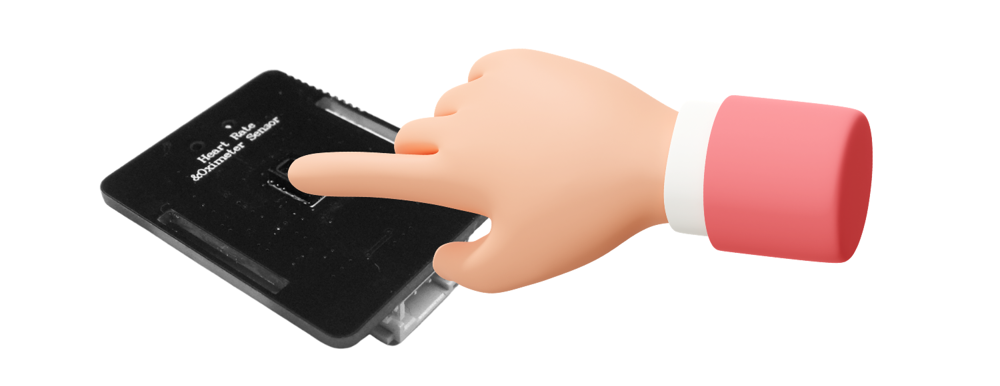

# Informations produit

## 1. Présentation du produit

Le module capteur de fréquence cardiaque et SpO2 Gravity: MAX30102 embarque la puce dédiée MAX30102 haute précision d'origine Maxim pour la mesure de la fréquence cardiaque et du SpO2, ainsi qu'un microcontrôleur intégrant un algorithme de fréquence cardiaque et SpO2 développé en interne : aucun programme de calcul complexe n'est nécessaire côté hôte, le module fournit directement des valeurs normalisées de fréquence cardiaque et de saturation en oxygène.

Le module acquiert les données physiologiques brutes par photopléthysmographie (PPG) ; le microcontrôleur embarqué réalise automatiquement l'ensemble du traitement — filtrage du signal, calcul des données et calibration des valeurs — puis transmet les résultats via les deux interfaces de communication courantes I2C et UART. Cela réduit considérablement la difficulté d'adaptation matérielle pour le développeur et l'occupation des ressources du MCU hôte ; même les débutants peuvent rapidement mener à bien leurs projets. En outre, un logiciel hôte PC dédié accompagne le module : il permet de lire les données directement depuis l'ordinateur et de visualiser en temps réel la fréquence cardiaque et le SpO2, pour un débogage simple et efficace.

## 2. Principe de mesure

Le module utilise la **photopléthysmographie (PPG)** pour une mesure physiologique non invasive : les artères du corps humain se dilatent et se contractent régulièrement au rythme des battements cardiaques, ce qui fait varier périodiquement le volume sanguin dans les vaisseaux ; cette variation de volume modifie directement la transmittance lumineuse des tissus au bout du doigt. Le module émet une lumière de longueur d'onde spécifique, recueille le signal lumineux réfléchi et capture la variation dynamique de la transmittance ; l'algorithme intégré en déduit précisément la fréquence cardiaque et la saturation en oxygène en temps réel.

## 3. Précautions d'utilisation

1. **La pression appliquée affecte la précision** : une pression inégale ou variable du bout du doigt sur le capteur perturbe le trajet optique et provoque des écarts sur les valeurs de fréquence cardiaque et de SpO2 ; pendant la mesure, gardez le doigt stable et une pression constante.
1. **Mise en place** : la zone de mesure de ce module se limite au bout du doigt ; la sonde de mesure n'a pas de sens d'orientation, la mise en place est simple.
1. **Mention « non-dispositif médical »** : ce produit est un module de mesure électronique grand public, et non un dispositif médical professionnel ; les données mesurées ne servent que de référence de santé quotidienne et ne doivent pas être utilisées pour le diagnostic clinique, la surveillance de maladies ou l'assistance médicale.

- Il suffit d'appliquer la pulpe du doigt sur le capteur et de la fixer avec le bracelet fourni.

## 4. Spécifications techniques

- Tension d'alimentation : 3,3-5 V
- Courant de fonctionnement : <15 mA
- Communication : I2C/UART
- Adresse I2C : 0x57
- Débit du port série : 9600
- Plage de température de fonctionnement : -40 °C~85 °C
- Dimensions du produit : 25,5*32 mm

**Brochage (sérigraphie) :**

| N° | Sérigraphie | Description de la fonction |
|---|---|---|
| 1 | D/T | Ligne de données I2C/TX |
| 2 | C/T | Ligne d'horloge I2C/RX |
| 3 | GND | Pôle négatif de l'alimentation |
| 4 | VCC | Pôle positif de l'alimentation |

## 5. Applications typiques

- Projets de développement pour la surveillance de la fréquence cardiaque et du SpO2 sur objets connectés portables
- Fabrication DIY de petits appareils domestiques de mesure de la fréquence cardiaque et du SpO2
- Systèmes de surveillance continue et de longue durée des signes physiologiques
- Matériel open source pour makers et projets de mesure physiologique en travaux pratiques d'électronique à l'université
