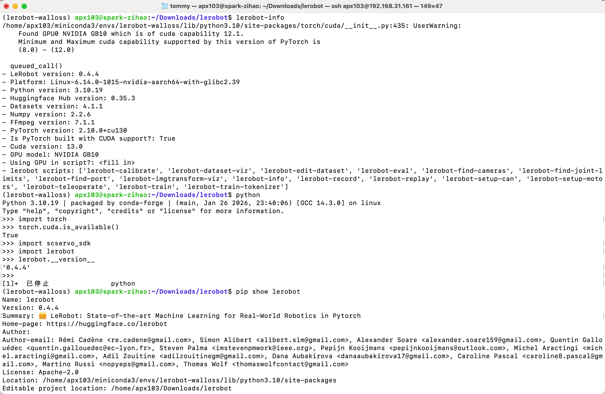
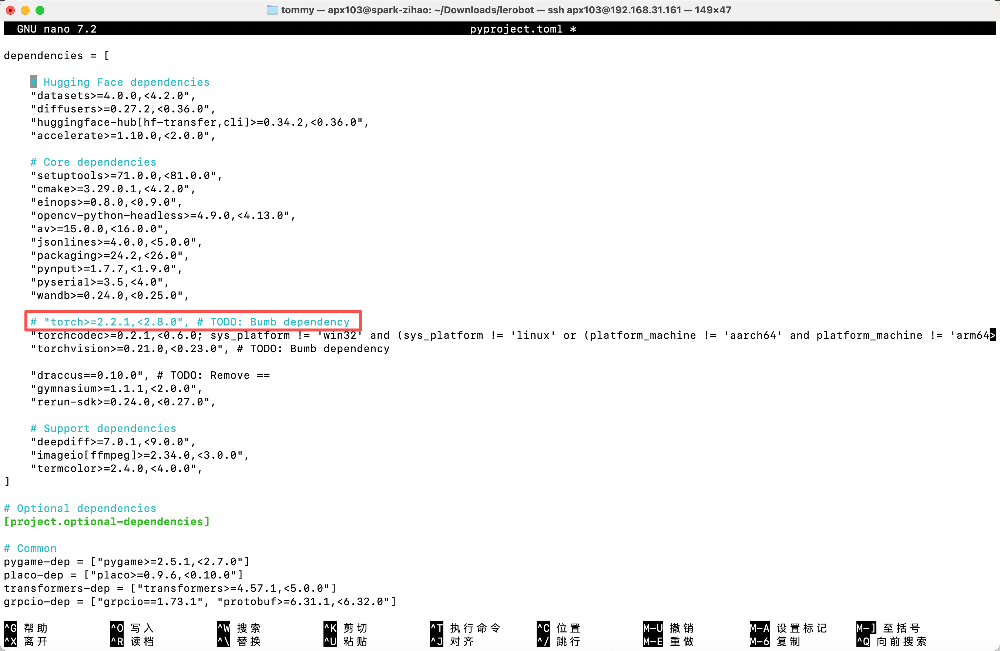
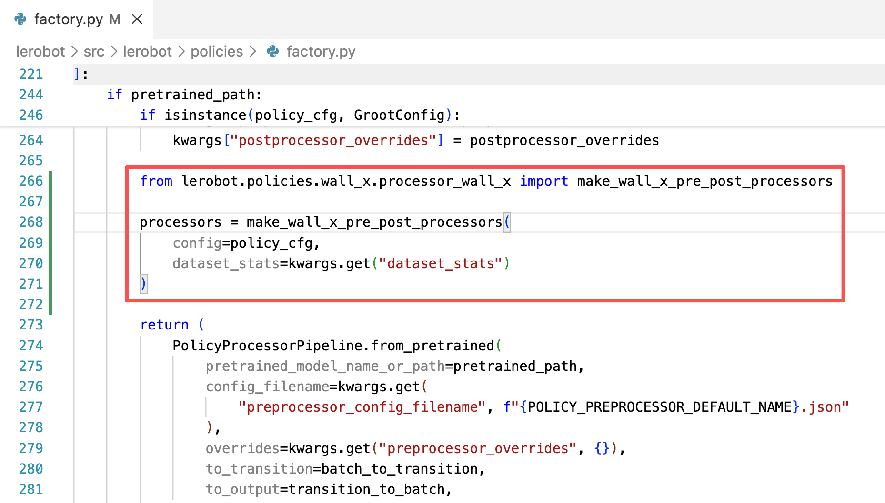

# Étape 8 : Inférence sur NVIDIA DGX Spark

## Installer l'environnement

- PyTorch

Installez PyTorch séparément depuis le site officiel, en utilisant la version CUDA 13.0

```Shell
pip3 install torch torchvision --index-url https://download.pytorch.org/whl/cu130
```



- Ensuite, commentez torch de son côté dans le fichier pyproject.toml



Exécutez ensuite pip install -e .

- Remarque : dans la ligne de commande d'inférence, remplacez le chemin policy.path par le chemin réel du modèle à l'intérieur du Spark

## Supprimer le jeu de données existant préfixé par eval (le cas échéant)

```Shell
sudo chmod 666 /dev/ttyACM*
```

```Shell
sudo rm -rf /home/apx103/.cache/huggingface/lerobot/Tommymy/eval_lerobot_my_dataset_shake_hands
```

## ACT

```Shell
lerobot-record  \
  --robot.type=so101_follower \
  --robot.port=/dev/ttyACM0 \
  --robot.cameras="{ front: {type: opencv, index_or_path: 0, width: 640, height: 480, fps: 60, fourcc: "MJPG"}}" \
  --robot.id=my_follower_arm \
  --display_data=false \
  --dataset.repo_id=Tommymy/eval_lerobot_my_dataset_shake_hands \
  --dataset.single_task="Shake Hands" \
  --dataset.episode_time_s=1000 \
  --policy.path=/home/apx103/Downloads/lerobot_output/shake/ACT/5K/pretrained_model
```

## SmolVLA

- Installer l'environnement

```Shell
conda activate base
conda create -y -n lerobot-smolvla python=3.10 -y
conda activate lerobot-smolvla
conda install ffmpeg=7.1.1 -c conda-forge -y

pip3 install torch torchvision --index-url https://download.pytorch.org/whl/cu130

cd lerobot
pip install -e ".[feetech,smolvla]"
```

- Inférence

```Shell
lerobot-record  \
  --robot.type=so101_follower \
  --robot.port=/dev/ttyACM0 \
  --robot.cameras="{ front: {type: opencv, index_or_path: 0, width: 640, height: 480, fps: 60, fourcc: "MJPG"}}" \
  --robot.id=my_follower_arm \
  --display_data=false \
  --dataset.repo_id=Tommymy/eval_lerobot_my_dataset_shake_hands \
  --dataset.single_task="Shake Hands" \
  --dataset.episode_time_s=1000 \
  --policy.path=/home/apx103/Downloads/lerobot_output/shake/smolvla/40K/pretrained_model
```

## WALL-OSS

- Installer l'environnement

```Shell
cd lerobot
pip install -e ".[feetech,wallx]"
```

- Ajouter le code



```Shell
lerobot-record  \
  --dataset.repo_id=Tommymy/eval_lerobot_my_dataset_shake_hands \
  --dataset.single_task="Shake Hands" \
  --policy.path=/home/apx103/Downloads/lerobot_output/shake/wallx/30K/pretrained_model \
  --dataset.push_to_hub=false \
  --robot.type=so101_follower \
  --robot.id=my_follower_arm \
  --robot.port=/dev/ttyACM0 \
  --robot.cameras="{front: {type: opencv, index_or_path: 0, width: 640, height: 480, fps: 60, fourcc: "MJPG"}}" \
  --display_data=false \
  --dataset.episode_time_s=1000
```

## pi0

- Installer l'environnement

```Shell
conda create -y -n lerobot-pi python=3.10 -y
conda activate lerobot-pi
conda install ffmpeg=7.1.1 -c conda-forge -y

cd lerobot
pip3 install torch torchvision --index-url https://download.pytorch.org/whl/cu130
pip install -e ".[feetech,pi]"
```

- Inférence

```Shell
lerobot-record  \
  --robot.type=so101_follower \
  --robot.port=/dev/ttyACM0 \
  --robot.cameras="{ front: {type: opencv, index_or_path: 0, width: 640, height: 480, fps: 60, fourcc: "MJPG"}}" \
  --robot.id=my_follower_arm \
  --display_data=false \
  --dataset.repo_id=Tommymy/eval_lerobot_my_dataset_shake_hands \
  --dataset.single_task="Shake Hands" \
  --dataset.episode_time_s=1000 \
  --dataset.push_to_hub=false \
  --policy.path=/home/apx103/Downloads/lerobot_output/shake/pi0/50K/pretrained_model
```

<RelatedProducts slugs="so-arm101" />
