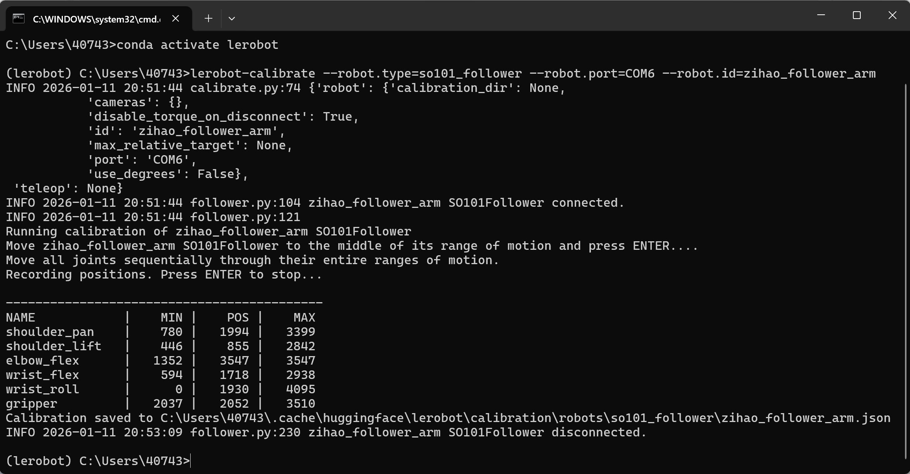
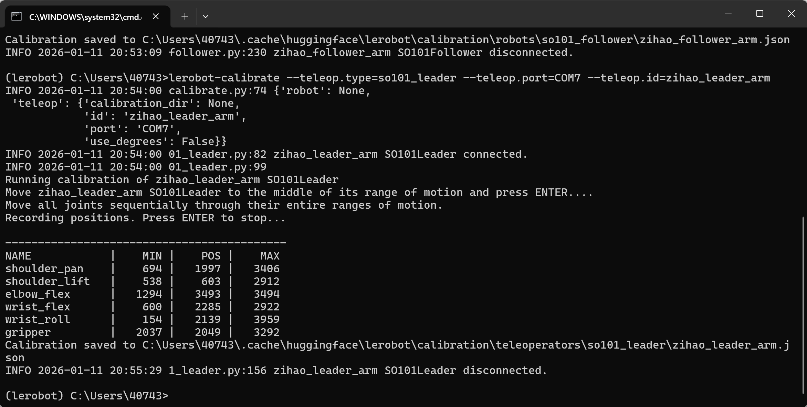

# Passo 3: Calibrare il braccio robotico (Windows)

È necessario collegare contemporaneamente il braccio attivo e il braccio passivo

## Calibrare il braccio passivo Follower

```Shell
lerobot-calibrate --robot.type=so101_follower --robot.port=COM6 --robot.id=my_follower_arm
```

Prima di premere Invio per avviare la calibrazione, portare il braccio robotico in posizione centrale: ogni giunto al centro del proprio intervallo utilizzabile.

Controllare i valori minimo e massimo di ogni giunto. Se un minimo supera 0 e inizia improvvisamente a decrescere da 4095, o un massimo supera 4095 e inizia a crescere da 0, eseguire una calibrazione della posizione centrale con il software PC Feetech, quindi ricalibrare il braccio robotico.



## Calibrare il braccio attivo Leader

```Shell
lerobot-calibrate --teleop.type=so101_leader --teleop.port=COM7 --teleop.id=my_leader_arm
```

Prima di premere Invio per avviare la calibrazione, portare il braccio robotico in posizione centrale: ogni giunto al centro del proprio intervallo utilizzabile.



## Posizione di esportazione del file

C:\Users\<nome-utente-Windows>\.cache\huggingface\lerobot\calibration\robots\so101_follower\my_follower_arm.json

C:\Users\<nome-utente-Windows>\.cache\huggingface\lerobot\calibration\teleoperators\so101_leader\my_leader_arm.json

## Calibrare con un altro braccio robotico

lerobot-calibrate --robot.type=so101_follower --robot.port=COM4 --robot.id=my_follower_arm

## Note

### ① Un braccio si ferma dopo aver raggiunto il limite

È necessario ricalibrare

[wx_camera_1768098182808.mp4](/downloads/wx_camera_1768098182808.mp4)

### ② Non si trova il servomotore


L'alimentazione del servomotore non è collegata; ricollega e ruota un po' il connettore

<RelatedProducts slugs="so-arm101" />
