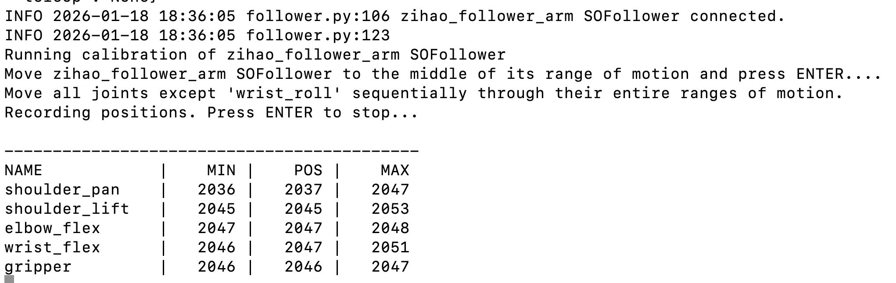

# 3단계: 로봇 암 캘리브레이션 (macOS)

## 포트 번호 복습

팔로워 암:

/dev/tty.usbmodem5AAF2193061

/dev/tty.wchusbserial5AAF2193061

리더 암:

/dev/tty.usbmodem5AAF2194741

/dev/tty.wchusbserial5AAF2194741

## 팔로워(Follower) 암 캘리브레이션

```Shell
lerobot-calibrate \
    --robot.type=so101_follower \
    --robot.port=/dev/tty.usbmodem5AAF2193061 \
    --robot.id=my_follower_arm
```

::: warning 캘리브레이션 주의

Enter 키로 캘리브레이션을 시작하기 전에 로봇 암을 중간 위치(모든 관절이 가동 범위의 중앙)에 두십시오.

각 관절의 최솟값과 최댓값을 확인하십시오. 최솟값이 0을 넘어 갑자기 4095에서 감소하거나, 최댓값이 4095를 넘어 0에서 증가하는 경우 Feetech 상위 소프트웨어로 중간 위치 캘리브레이션을 수행한 뒤 로봇 암 캘리브레이션을 다시 진행하십시오.

:::


## 리더(Leader) 암 캘리브레이션

```Shell
lerobot-calibrate \
    --teleop.type=so101_leader \
    --teleop.port=/dev/tty.usbmodem5AAF2194741 \
    --teleop.id=my_leader_arm
```

::: warning 캘리브레이션 주의

Enter 키로 캘리브레이션을 시작하기 전에 로봇 암을 중간 위치(모든 관절이 가동 범위의 중앙)에 두십시오.

:::


## 캘리브레이션 설정 파일 확인

```Shell
sudo nano /Users/<사용자명>/.cache/huggingface/lerobot/calibration/teleoperators/so101_leader/my_leader_arm.json
```

## 자주 발생하는 Bug

- 서보모터 하나 또는 몇 개를 찾지 못함



## 주의 사항

### ① 한쪽 암이 리밋에 도달한 후 움직이지 않음

재캘리브레이션이 필요합니다

[wx_camera_1768098182808.mp4](/downloads/wx_camera_1768098182808.mp4)

### ② 서보모터를 찾을 수 없음


서보모터 전원이 연결되지 않음

<RelatedProducts slugs="so-arm101" />
