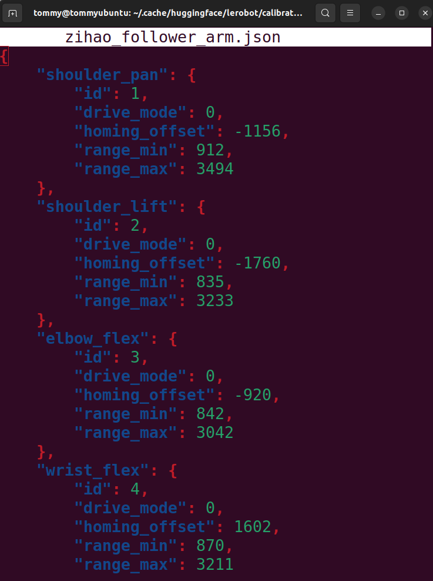

# Etapa 3: Calibrar o braço robótico (Ubuntu)

## Conceder permissões à porta

Permitir que todos os usuários tenham permissão de leitura e escrita nesses dispositivos de porta serial

```Shell
sudo chmod 666 /dev/ttyACM*
```

## Calibrar o braço seguidor (Follower)

```Shell
lerobot-calibrate \
    --robot.type=so101_follower \
    --robot.port=/dev/ttyACM0 \
    --robot.id=my_follower_arm
```

Antes de pressionar Enter para iniciar a calibração, coloque o braço robótico na posição central: cada junta no centro da sua faixa utilizável.

Observe os valores mínimo e máximo de cada junta. Se um mínimo ultrapassar 0 e começar a diminuir a partir de 4095, ou um máximo ultrapassar 4095 e começar a aumentar a partir de 0, faça uma calibração de posição central com o software de PC da Feetech e calibre o braço robótico novamente.


## Calibrar o braço líder (Leader)

```Shell
lerobot-calibrate \
    --teleop.type=so101_leader \
    --teleop.port=/dev/ttyACM1 \
    --teleop.id=my_leader_arm
```

Antes de pressionar Enter para iniciar a calibração, coloque o braço robótico na posição central: cada junta no centro da sua faixa utilizável.


## Ver o arquivo de configuração de calibração

```Shell
sudo nano /home/<usuario>/.cache/huggingface/lerobot/calibration/robots/so101_follower/my_follower_arm.json
```



## Observações

### ① Um dos braços para de se mover após atingir o limite

É necessário recalibrar

[wx_camera_1768098182808.mp4](/downloads/wx_camera_1768098182808.mp4)

### ② Servos não encontrados


A alimentação do servo não está conectada

<RelatedProducts slugs="so-arm101" />
