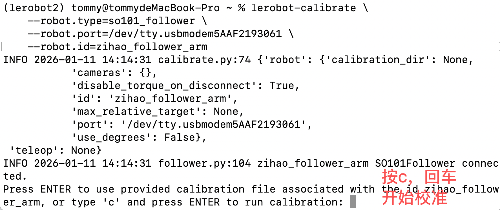

# Step 3: Arm Calibration (macOS)

## Review the port numbers

Follower:

/dev/tty.usbmodem5AAF2193061

/dev/tty.wchusbserial5AAF2193061

Leader:

/dev/tty.usbmodem5AAF2194741

/dev/tty.wchusbserial5AAF2194741

## Calibrate the follower arm (Follower)

```Shell
lerobot-calibrate \
    --robot.type=so101_follower \
    --robot.port=/dev/tty.usbmodem5AAF2193061 \
    --robot.id=my_follower_arm
```

Before pressing Enter to start calibration, put the robot arm in its middle position — each joint at the center of its usable range.

Watch the minimum and maximum values of each joint. If a minimum jumps across 0 and starts decreasing from 4095, or a maximum passes 4095 and starts increasing from 0, perform a middle-position calibration with the Feetech host software, then calibrate the robot arm again.




## Calibrate the leader arm (Leader)

```Shell
lerobot-calibrate \
    --teleop.type=so101_leader \
    --teleop.port=/dev/tty.usbmodem5AAF2194741 \
    --teleop.id=my_leader_arm
```

Before pressing Enter to start calibration, put the robot arm in its middle position — each joint at the center of its usable range.


## View the calibration configuration file

```Shell
sudo nano /Users/<username>/.cache/huggingface/lerobot/calibration/teleoperators/so101_leader/my_leader_arm.json
```

## Common bugs

- One or several of the servos cannot be found


## Notes

### ① Once one arm reaches its limit, it stops moving

Recalibration is required

[wx_camera_1768098182808.mp4](/downloads/wx_camera_1768098182808.mp4)

### ② Servos cannot be found


The servo power is not plugged in

<RelatedProducts slugs="so-arm101" />
