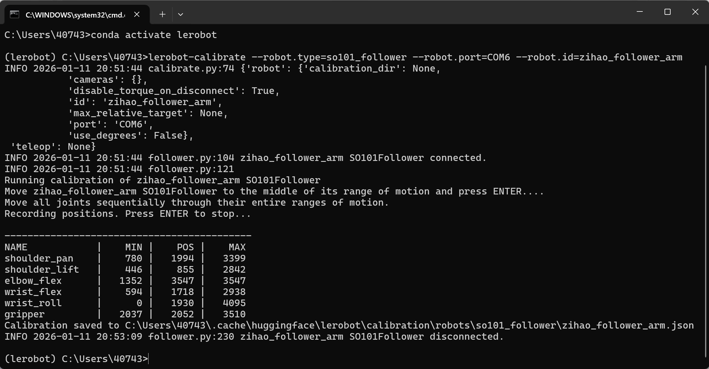
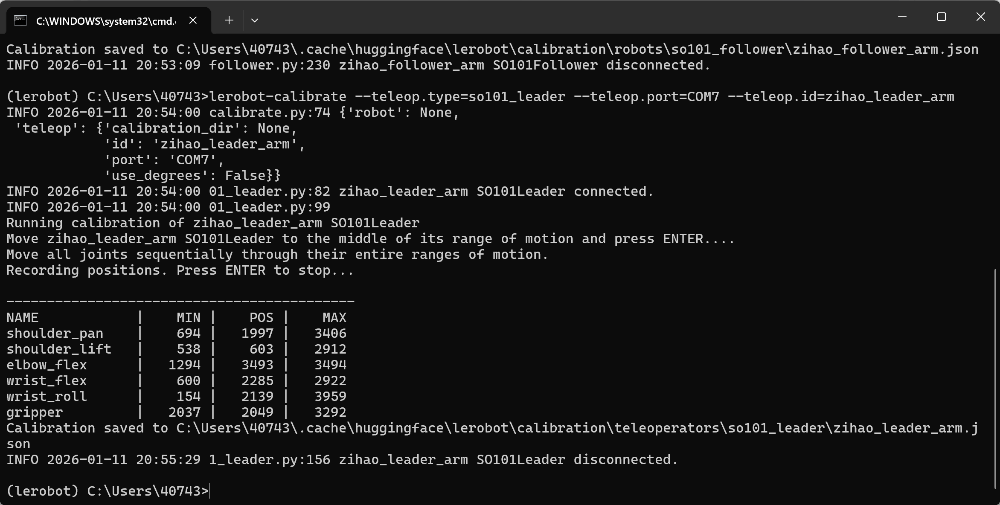

# Step 3: Arm Calibration (Windows)

Both the leader arm and the follower arm must be connected at the same time

## Calibrate the follower arm (Follower)

```Shell
lerobot-calibrate --robot.type=so101_follower --robot.port=COM6 --robot.id=my_follower_arm
```

Before pressing Enter to start calibration, put the robot arm in its middle position — each joint at the center of its usable range.

Watch the minimum and maximum values of each joint. If a minimum jumps across 0 and starts decreasing from 4095, or a maximum passes 4095 and starts increasing from 0, perform a middle-position calibration with the Feetech host software, then calibrate the robot arm again.



## Calibrate the leader arm (Leader)

```Shell
lerobot-calibrate --teleop.type=so101_leader --teleop.port=COM7 --teleop.id=my_leader_arm
```

Before pressing Enter to start calibration, put the robot arm in its middle position — each joint at the center of its usable range.



## File export location

C:\Users\<Windows-username>\.cache\huggingface\lerobot\calibration\robots\so101_follower\my_follower_arm.json

C:\Users\<Windows-username>\.cache\huggingface\lerobot\calibration\teleoperators\so101_leader\my_leader_arm.json

## Calibrating a different robot arm

lerobot-calibrate --robot.type=so101_follower --robot.port=COM4 --robot.id=my_follower_arm

## Notes

### ① Once one arm reaches its limit, it stops moving

Recalibration is required

[wx_camera_1768098182808.mp4](/downloads/wx_camera_1768098182808.mp4)

### ② Servos cannot be found


The servo power is not plugged in; plug and unplug it again and turn the connector a little

<RelatedProducts slugs="so-arm101" />
