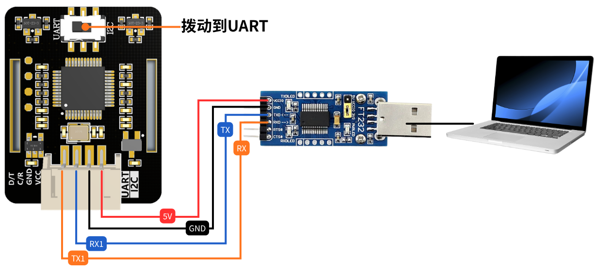

# PC 端上位机

## 📋 功能介绍

这是一个图形化的心率血氧监测上位机程序，支持以下功能：

1. ✅ **串口选择** - 自动扫描可用串口
1. ✅ **波特率选择** - 支持9600/19200/38400/57600/115200
1. ✅ **连接/断开** - 一键连接/断开模块
1. ✅ **启动/关闭采集** - 控制传感器LED亮灭
1. ✅ **开始/停止监测** - 实时显示数据
1. ✅ **实时数据显示** - 血氧、心率、温度

---

## 🔌 硬件连接

| 心率血氧模块 | USB转TTL模块 |
|---|---|
| VCC | 5V (重要！不要接3.3V) |
| GND | GND |
| TX | RX (交叉连接) |
| RX | TX (交叉连接) |



⚠️ **注意：模块拨片拨动到UART，TX和RX必须交叉连接！**

---

## 🚀 运行程序

### 方法一：直接运行Python脚本

1. 安装依赖库：

```bash
pip install pyserial
```

1. 运行程序：

```bash
cd D:\JUXI_HeartRate_SPO2\python\windows
```

```bash
python HeartRateOximeter.py
```

---

## 📖 使用步骤

### 第一步：连接硬件

1. 按照上面的接线表连接传感器和USB转TTL

```text
VCC->VCC
GND->GND
RX->TX
TX->RX
```

1. 将USB转TTL插入电脑USB口

### 第二步：打开程序

运行 `HeartRateOximeter.exe`

### 第三步：串口设置

1. 选择正确的串口号（如 COM3）
1. 波特率选择 **9600**（默认）
1. 点击【连接】按钮

### 第四步：启动采集

1. 连接成功后，点击【启动采集】
1. ✅ 传感器LED灯会亮起

### 第五步：开始监测

1. 将手指放在传感器上
1. 点击【开始监测】
1. 查看实时数据

---

## 📊 界面说明

```text
┌─────────────────────────────────────────┐
│           串口设置                       │
│  串口:  [COM3  ↓]  [刷新]               │
│  波特率:[9600  ↓]  [连接]               │
├─────────────────────────────────────────┤
│           模块控制                       │
│  [启动采集]  [开始监测]                 │
├─────────────────────────────────────────┤
│           实时数据                       │
│  血氧 (SPO2):       98 %                │
│  心率 (Heart Rate): 75 Times/min        │
│  温度 (Temperature): 36.6 °C            │
│  状态:  正在监测...                     │
├─────────────────────────────────────────┤
│           使用提示                       │
│  1. 接线：VCC->5V, GND->GND, RX->TX, TX->RX          │
│  2. 点击连接后再启动采集                               │
│  3. 启动采集后传感器LED会亮起                           │
└─────────────────────────────────────────┘
```
---

## 📋 数据解读

| 数据 | 正常范围 | 说明 |
|---|---|---|
| 血氧 (SPO2) | 95% - 100% | 低于90%建议就医 |
| 心率 | 60 - 100 Times/min | 成人正常范围 |
| 温度 | 25 - 35 °C | 模块板载温度，非体温 |

**注意**：刚启动或手指未放好时，数据可能显示为 -1，属于正常现象。

---

## ❓ 常见问题

### Q1: 找不到串口怎么办？

**A:**

1. 检查USB转TTL驱动是否安装正确
1. 重新插拔USB线
1. 点击【刷新】按钮重新扫描

### Q2: 连接失败怎么办？

**A:**

1. 确认串口选择正确
1. 确认串口没有被其他程序占用（如串口助手、Arduino IDE）
1. 检查USB转TTL是否正常工作

### Q3: 点击启动采集后LED不亮？

**A:**

1. 检查VCC是否接的是5V（不是3.3V）
1. 检查TX/RX是否交叉连接
1. 确认传感器模块本身没有损坏

### Q4: 数据一直显示 -1？

**A:**

1. 确认已经点击【启动采集】
1. 将手指正确放在传感器上，完全覆盖LED区域
1. 保持手指稳定，等待几秒钟
1. 检查接线是否松动

### Q5: 程序无响应？

**A:**

1. 先点击【停止监测】
1. 再点击【关闭采集】
1. 最后点击【断开】
1. 重启程序

---

## ⚠️ 注意事项

1. **接线顺序**：先接传感器，再插USB
1. **断开顺序**：先停止监测，再关闭采集，最后断开连接
1. **电源要求**：传感器必须接5V电源，3.3V可能无法正常工作
1. **手指放置**：测量时手指要完全覆盖光学区域，不要用力按压
1. **环境要求**：避免强光直射传感器

---

## 📞 技术支持

如有问题，请检查：

1. 硬件接线是否正确（特别是TX/RX交叉）
1. 电源是否为5V
1. USB转TTL驱动是否正常
1. 串口是否被其他程序占用
