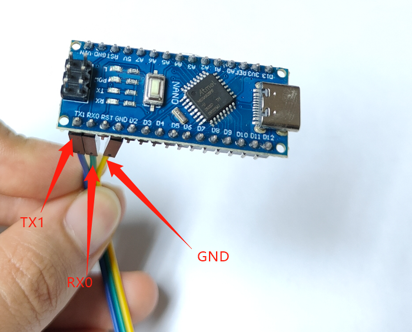

# Arduino Nano 使用教程

## 接线方式（舵机驱动板 + Nano 板）

**看清楚 Nano 板（即 328P 开发板）的针脚位置！**

下面描述的是使用单片机的调试过程。单片机本身会不断循环运行演示程序，只需断开数据线即可停止。

## 运行「02 演示程序」

1. 自行安装 Arduino IDE。

2. 根据**左手还是右手**，打开对应的 `.ino` 文件。

   

3. 编译上传 Arduino 程序到 Nano 板之前，先在「库管理器」里安装 **FTServo 库** 和 **SCServo 库**。

   

4. Nano 板类型选择「**Arduino Nano**」。

   

5. 编译并上传。

> **注意：** 此时电脑只单独连接到 Nano 板，Nano 板先不连接舵机驱动板（即不和灵巧手连接）。

上传成功后，将 Nano 板通过三根跳线连接到舵机驱动板上，舵机连接到舵机驱动板，参考 [MEGA328P Nano 板调试时的接线方式](https://juxitech.feishu.cn/wiki/Wt46wtt26imdWkkQlxTcL87qnHd#share-HdS4dNgwyo2seVxRZ9PcZ1R3nuc)。

灵巧手会不断循环运行「02 演示程序」，运行结果如下：

