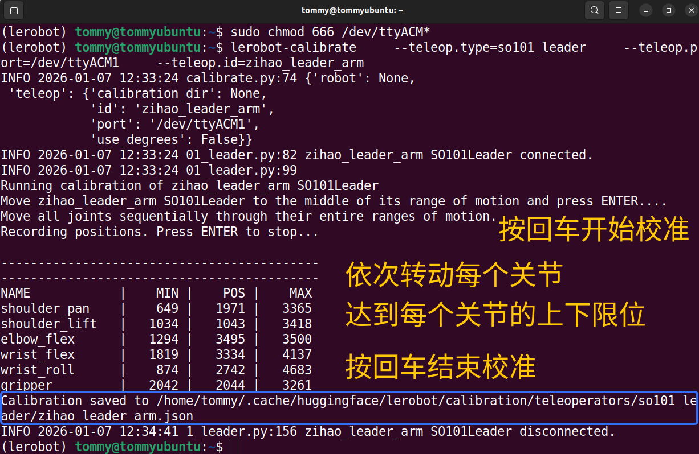
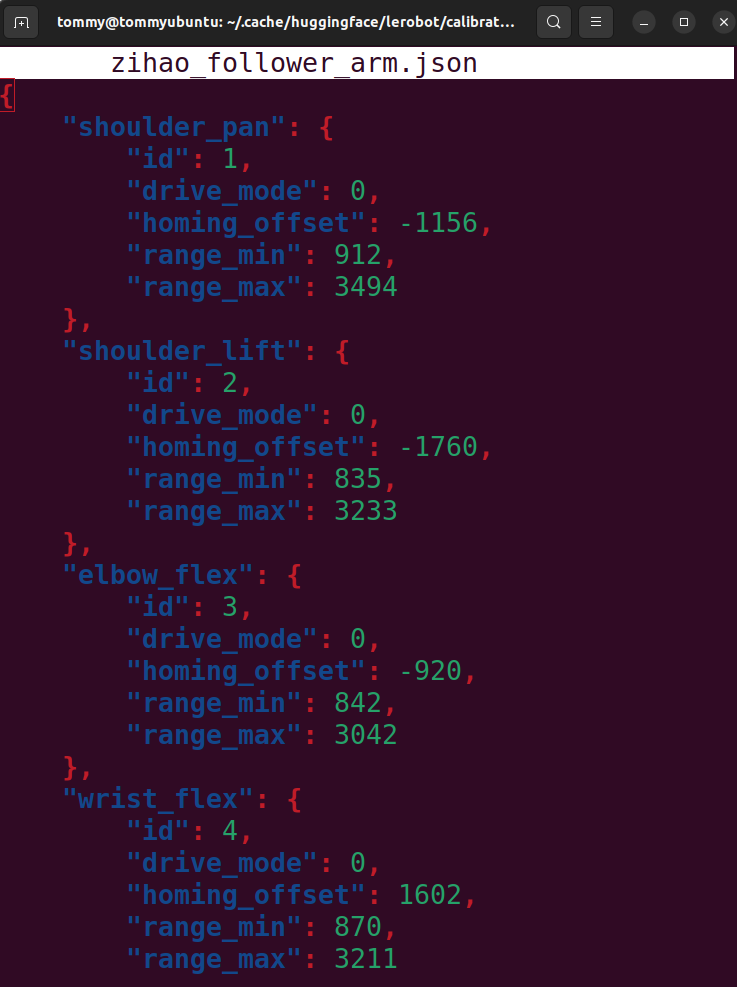

# 第三步:校准机械臂(Ubuntu)

## 给端口赋予权限

让所有用户都有权限读写这些串口设备

```Shell
sudo chmod 666 /dev/ttyACM*
```

## 校准从动臂Follower

```Shell
lerobot-calibrate \
    --robot.type=so101_follower \
    --robot.port=/dev/ttyACM0 \
    --robot.id=my_follower_arm
```

按回车开始校准前，先让机械臂处于中位状态，即所有关节都处于可转动范围的中间位置。

注意看每个关节的最小值和最大值。如果出现最小值越过0突然变成4095递减，或者最大值越过4095变成0递增的情况，请使用飞特上位机进行中位校准，再重新进行标定机械臂。


## 校准Leader主动臂

```Shell
lerobot-calibrate \
    --teleop.type=so101_leader \
    --teleop.port=/dev/ttyACM1 \
    --teleop.id=my_leader_arm
```

按回车开始校准前，先让机械臂处于中位状态，即所有关节都处于可转动范围的中间位置。



## 查看校准配置文件

```Shell
sudo nano /home/<你的用户名>/.cache/huggingface/lerobot/calibration/robots/so101_follower/my_follower_arm.json
```



## 注意事项

### ①有一个臂达到限位后不动了

需要重新校准

[wx_camera_1768098182808.mp4](/downloads/wx_camera_1768098182808.mp4)

### ②找不到舵机


舵机电没插

<RelatedProducts slugs="so-arm101" />
