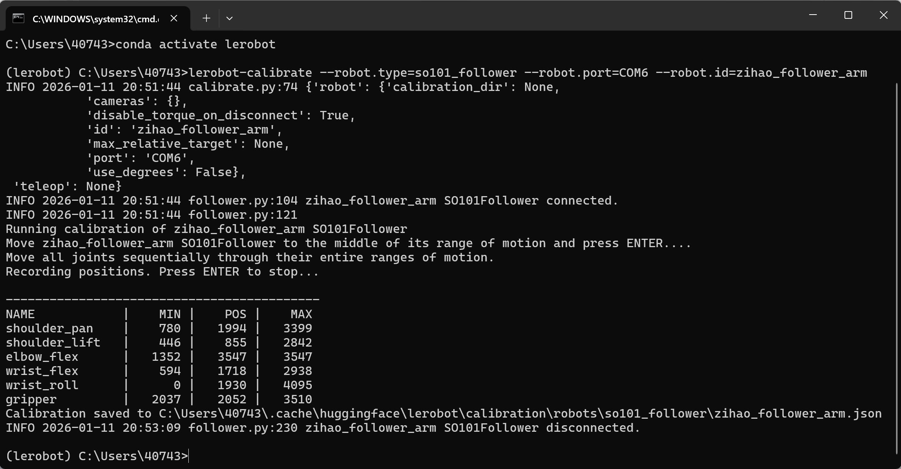
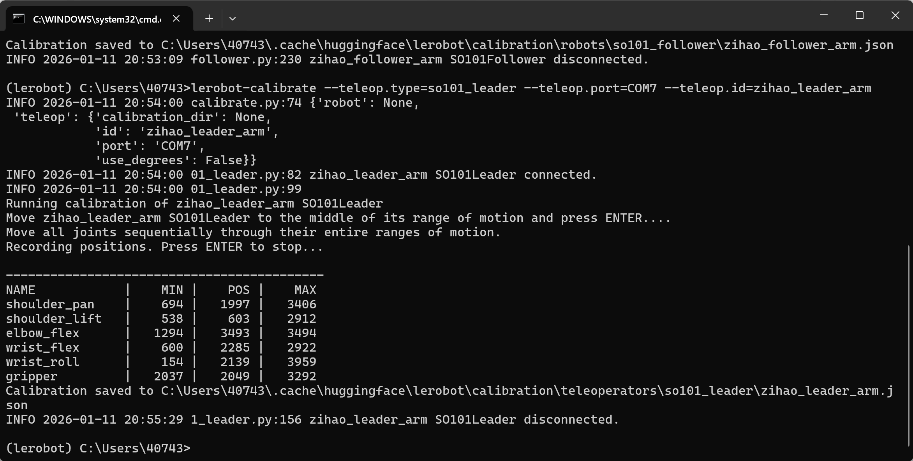

# 第三步:校准机械臂(Windows)

需要同时接上主动臂和从动臂

## 校准从动臂Follower

```Shell
lerobot-calibrate --robot.type=so101_follower --robot.port=COM6 --robot.id=my_follower_arm
```

::: warning 标定提醒

按回车开始校准前，先让机械臂处于中位状态，即所有关节都处于可转动范围的中间位置。

注意看每个关节的最小值和最大值。如果出现最小值越过0突然变成4095递减，或者最大值越过4095变成0递增的情况，请使用飞特上位机进行中位校准，再重新进行标定机械臂。

:::



## 校准主动臂Leader

```Shell
lerobot-calibrate --teleop.type=so101_leader --teleop.port=COM7 --teleop.id=my_leader_arm
```

::: warning 标定提醒

按回车开始校准前，先让机械臂处于中位状态，即所有关节都处于可转动范围的中间位置。

:::



## 文件导出位置

C:\Users\<你的Windows用户名>\.cache\huggingface\lerobot\calibration\robots\so101_follower\my_follower_arm.json

C:\Users\<你的Windows用户名>\.cache\huggingface\lerobot\calibration\teleoperators\so101_leader\my_leader_arm.json

## 换机械臂校准

lerobot-calibrate --robot.type=so101_follower --robot.port=COM4 --robot.id=my_follower_arm

## 注意事项

### ①有一个臂达到限位后不动了

需要重新校准

[wx_camera_1768098182808.mp4](/downloads/wx_camera_1768098182808.mp4)

### ②找不到舵机


舵机电没插，重新插拔并转一转插口

<RelatedProducts slugs="so-arm101" />
